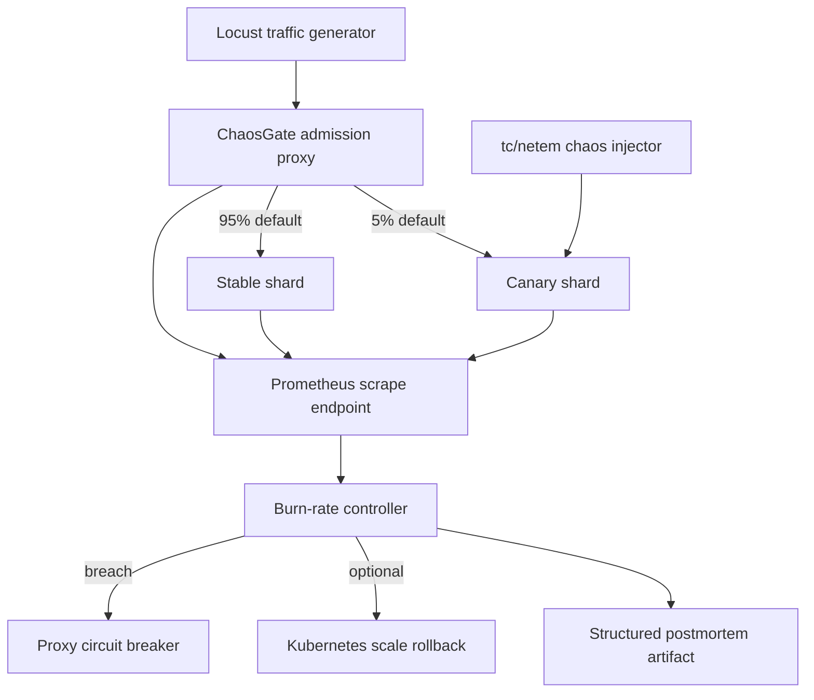
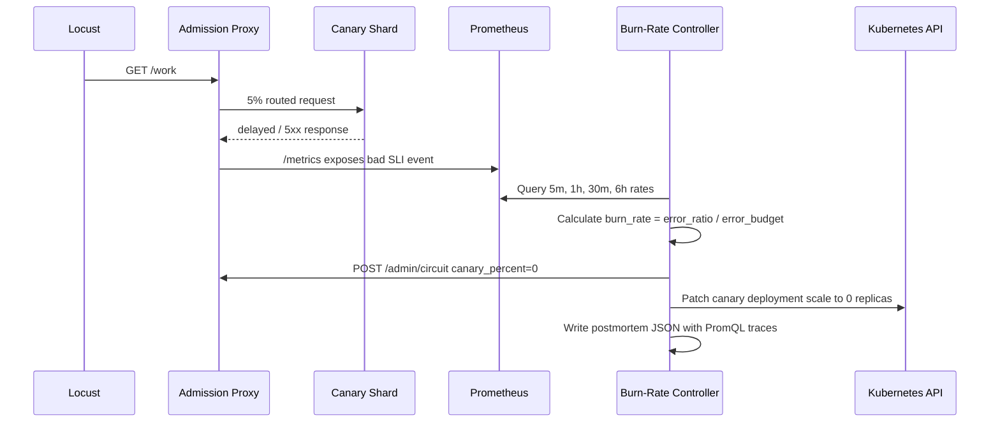

# ChaosGate Architecture

## System Overview



## Reliability Model

ChaosGate models availability and latency as request-based SLI events:

```text
bad = status_code >= 500 OR proxy_latency_ms > LATENCY_SLO_MS
error_ratio = bad_events / total_events
burn_rate = error_ratio / (1 - SLO_TARGET)
```

For a `99.9%` SLO, the error budget is `0.1%`. A `1%` error ratio burns the budget at `10x`.

The controller evaluates the Google SRE Workbook multi-window, multi-burn-rate alert pairs:

| Severity | Short Window | Long Window | Threshold | Budget Impact |
| --- | --- | --- | --- | --- |
| Page | 5m | 1h | 14.4x | 2% of a 30-day budget in 1h |
| Ticket | 30m | 6h | 6x | 5% of a 30-day budget in 6h |

The canary rollback gate executes only when both windows in a severity pair breach. This filters one-scrape spikes while still catching severe canary failures quickly under load.

## PromQL Signatures

Total canary SLI event rate:

```promql
sum(rate(chaosgate_proxy_sli_events_total{route="canary"}[1h]))
```

Bad canary SLI event rate:

```promql
sum(rate(chaosgate_proxy_sli_events_total{route="canary",outcome="bad"}[1h]))
```

Burn rate:

```promql
(
  sum(rate(chaosgate_proxy_sli_events_total{route="canary",outcome="bad"}[1h]))
/
  sum(rate(chaosgate_proxy_sli_events_total{route="canary"}[1h]))
) / 0.001
```

## Rollback Flow



## Production Hardening Notes

- Admin endpoints require `x-chaosgate-token`; use a secret manager in real deployments.
- The controller is idempotent: after one rollback, it keeps observing but does not repeatedly execute rollback actions.
- Kubernetes RBAC is scoped to the canary deployment scale subresource.
- Fault injection requires `NET_ADMIN`; keep it out of normal application pods except in test environments.
- The proxy exports SLI metrics from the user-visible edge, which prevents healthy upstream internals from hiding broken end-to-end behavior.

